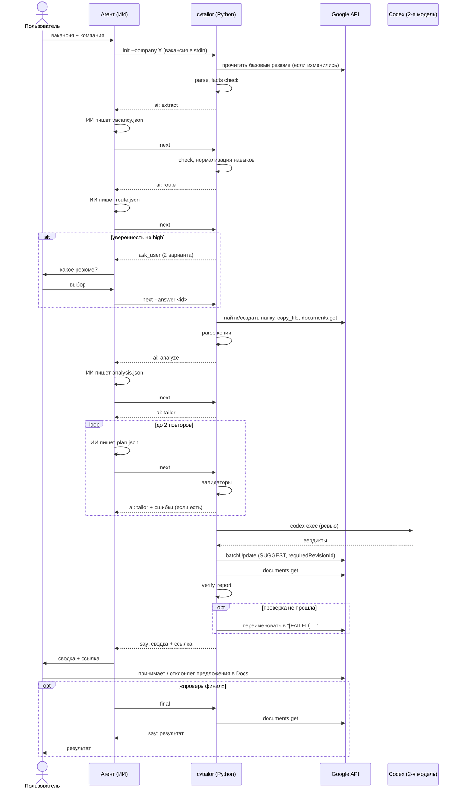

# Дизайн-документ v4: CV Tailor

Статус: v1-скоуп, 2026-11-25. Изменение относительно v3.2: Google-бэкенд — собственный OAuth в Python (настроен и проверен 2026-11-25, [`docs/google-setup.md`](docs/google-setup.md)). Коннекторы Claude больше не используются. Агент делает только ИИ-шаги и разговор с пользователем, всё остальное выполняет `cvtailor`. Цель версии: рабочий инструмент как можно быстрее; остальное в разделе 15 «Отложено на v2».

## 1. Цель и границы

Инструмент берёт текст вакансии (на любом языке) и одно из базовых английских резюме (обычно три, под разные роли) и создаёт в Google Drive **новую копию** резюме, подогнанную под вакансию. Оригиналы не меняются. Правки вносятся в копию в **режиме предложений** Google Docs: пользователь принимает, отклоняет или редактирует каждую прямо в документе.

Входит в v1:
- выбор базового резюме (или явное указание `--resume <id>`);
- анализ покрытия требований и релевантности блоков;
- план правок: replace, insert, delete буллетов, правка title, summary и строк skills;
- проверка плана кодом и второй моделью (если доступна);
- применение к копии как предложения, отчёт `review.md`;
- проверка результата.

Не входит в v1: загрузка .docx, веб-сервер, review.html, Jev, перевод отдельным этапом, проверка числа страниц, правка контактов, образования и языков, README для чужих пользователей.

## 2. Принципы

1. **ИИ только там, где нужно понимание текста.** Извлечение требований, выбор резюме, анализ, тексты правок, независимое ревью. Всё остальное — Google API, индексы, имена, проверки, отчёты, порядок шагов — делает Python.
2. **Python ведёт прогон.** `cvtailor next` сам выполняет все детерминированные шаги подряд (включая обращения к Google) и останавливается только там, где нужен ИИ или пользователь.
3. **`facts.json` — единый источник правды.** Структурированная версия Master CV, вычитанная пользователем. Каждая правка ссылается на факты.
4. **Копия, а не редактирование оригинала.**
5. **Локальные файлы + Google Doc.** Артефакты лежат в `runs/<run>/`; решение пользователь принимает в самом документе.
6. **Агент-агностичность.** Агенту нужны только shell и умение писать JSON по промпту: Claude Code, Codex или любой другой. Google-доступ принадлежит `cvtailor`, а не агенту.

## 3. Кто что делает

| Исполнитель | Задачи |
|---|---|
| **ИИ агента** | извлечь требования вакансии; выбрать резюме; оценить покрытие и релевантность, отобрать факты; написать план правок и исправить его по ошибкам валидатора; задать пользователю вопрос, который сформулировал `cvtailor`; показать итоговую сводку |
| **ИИ второй модели** (`codex exec`) | вердикт по каждой правке. Вызывается из Python подпроцессом |
| **Python `cvtailor`** | OAuth и токены; чтение, копирование, создание папок, `batchUpdate`, переименование в Google; состояние прогона; сборка входов для ИИ и проверка их ответов; нормализация навыков; имена папки и документа; парсинг; валидаторы; вызов второй модели; проверка результата; отчёты и текст сводки |
| **Пользователь** | вставить вакансию; выбрать резюме при неуверенности; ревью предложений в Docs; раз в 7 дней войти в Google заново (статус Testing) |

### Что ушло от агента к скрипту по сравнению с v3.2

| Было у агента (коннекторы) | Теперь |
|---|---|
| `search_files`, `create_file`, `copy_file`, `update_doc`, `update_file` с аргументами от `next` | `cvtailor` вызывает Drive/Docs API сам |
| `read_doc` и копирование 100 КБ JSON в файл через поведение харнесса | `cvtailor` читает документ сам и пишет файл |
| передача id копии и имён папок через `set` / `--candidates` | не нужно |
| передача `requests.json` в `update_doc` (риск искажения) | не нужно |
| отдельная команда `resumes sync` перед прогоном | на шаге копирования `facts check` проверяет цитаты выбранного резюме, `role_map` сопоставляет роли; кэша базовых резюме нет (3 чтения за прогон) |

У агента остались только пять ИИ-шагов и разговор с пользователем. Число шагов агента за прогон: примерно с 20 до 7.

Шаблон каждого ИИ-шага не меняется: `cvtailor` пишет вход в `runs/<run>/<step>.pack.md` → ИИ пишет JSON по промпту `prompts/<step>.md` → `cvtailor next` проверяет схему (для плана — валидаторы). Ошибка → `next` снова выдаёт тот же шаг с ошибками, до 2 повторов.

## 4. Последовательность прогона



## 5. Шаги прогона

Папка прогона: `runs/<YYYY-MM-DD>_<company-slug>/` (суффикс `-2`, `-3` при повторе в тот же день). `state.json` хранит пройденные шаги, id папки и копии. Прогон можно продолжить с места остановки.

| # | Шаг | ИИ | Python (включая Google API) | Выход |
|---|---|---|---|---|
| 1 | Начало | — | папка прогона, `vacancy.txt`, `state.json`, `runs/.current` | `state.json` |
| 2 | Извлечение вакансии (любой язык → англ.) | ✅ `extract.md` | pack, check, нормализация навыков по `skills[].aliases` | `vacancy.json` |
| 3 | Выбор резюме (пропуск при одном или `--resume`) | ✅ `route.md` | pack, check; при `confidence != high` → `ask_user` | `route.json` |
| 4 | Папка, имя, копия | — | найти или создать папку компании, выбрать имя с индексом, `files.copy`, `documents.get` копии, `parse`, `facts check` для выбранного резюме, `role_map`; проблемы → `say` и блок до ИИ-шагов анализа | `copy.json`, `blocks.json` |
| 5 | Анализ | ✅ `analyze.md` | pack, check | `analysis.json` |
| 6 | План правок | ✅ `tailor.md` | pack, валидаторы, ≤2 повтора | `plan.json`, `validation.json` |
| 7 | Ревью второй моделью | ✅ (Codex) | подпроцесс `codex exec`, проверка схемы | `review.json` |
| 8 | Применение | — | `requests.json`, `documents.batchUpdate` (`SUGGEST`) | `requests.json` |
| 9 | Проверка и отчёт | — | `documents.get`, `verify`, при провале переименование; `review.md`, `summary.txt` | `after.json`, `review.md` |
| 10 | Финал (по запросу) | — | `documents.get`, `final` | `final.json` |

Шаги 4, 8 и 9 выполняются внутри одного вызова `next` без участия агента.

План строится по блокам копии. `requiredRevisionId` гарантирует, что между чтением и применением копию никто не менял.

### `cvtailor next`

Выполняет детерминированные шаги, пока не дойдёт до одного из действий, и печатает его в JSON:

```json
{"action": "ai", "step": "tailor",
 "prompt": "prompts/tailor.md", "input": "runs/2026-11-25_acme/tailor.pack.md",
 "output": "runs/2026-11-25_acme/plan.json",
 "errors": [{"op": 3, "rule": "numbers", "detail": "\"40%\" not in evidence f-014"}]}
```

| `action` | Что делает агент |
|---|---|
| `ai` | читает промпт и вход, пишет JSON в `output`, снова вызывает `next` |
| `ask_user` | задаёт вопрос из поля `question`, ответ передаёт `next --answer ...` |
| `say` | показывает текст пользователю как есть |
| `auth` | говорит пользователю выполнить `cvtailor login` (открывает браузер), затем снова вызывает `next`; шаг повторится |
| `done` | конец |

Повторная выдача шага без файла попытку не тратит, неверный ответ — тратит; старый ответ переименовывается в `*.stale*`/`*.attempt*`. После исчерпания попыток шаг блокируется (`say`), снять блок — `cvtailor next --from STEP`; `--from` на шаг дальше текущего и на шаги до `apply` после применения правок запрещены. Неожиданные ошибки возвращаются одним действием `say`, состояние сохраняется. После `cvtailor final` в `final.json` — исходы правок (`accepted`/`edited`/`rejected`).

`SKILL.md` сводится к описанию этого цикла.

### `cvtailor run` (v2, V1)

Тот же автомат, но ИИ-шаги выполняет сам Python (`ai.py`): на действие `ai` он вызывает команду из `ai.command` (по умолчанию `claude -p --model <модель шага> --output-format json --tools "" …`) в пустой временной папке, передаёт на stdin промпт шага, вход и — на повторе — прошлый ответ (`<output>.attemptN`), пишет ответ в `output` и снова вызывает `next`. Каждый вызов — свежий контекст только с промптом и входом. Журнал — `runs/<run>/ai_calls.jsonl` (модель, время, символы, токены и стоимость из ответа `claude`). `run` останавливается на `ask_user` (в терминале — вопрос через `input()`, `--non-interactive` — первый вариант с пометкой в сводке), `say`, `auth`, `done`, при ошибке вызова модели (`say`, состояние не тронуто) и действием `continue`, если прошло больше `ai.max_run_seconds` (чтобы вызов из чата не упёрся в таймаут shell). Скилл в обычном режиме только запускает `cvtailor run --json` и передаёт вопросы; ручной режим через `next` остаётся запасным.

## 6. Роутинг и анализ (ИИ)

**Роутинг (`route.json`).** Вход: `vacancy.json` + для каждого резюме `target_role`, описание роли и текст SUMMARY из кэша. Выход:

```json
{"choice": "senior-sdet", "confidence": "high", "ranking": ["senior-sdet", "qa-platform", "qa-automation"], "reason": "..."}
```

`confidence`: `high` — продолжаем; `medium` / `low` — пользователь выбирает из первых двух.

**Анализ (`analysis.json`).** Вход: `vacancy.json`, `blocks.json` копии с отметкой редактируемых блоков, все `verified` факты и карта «факт → блок» из `used_in`.

Покрытие, по каждому требованию вакансии:

| Статус | Значение |
|---|---|
| `covered` | в резюме уже есть явное подтверждение |
| `in_facts` | в резюме нет, в `facts.json` есть подходящий факт → кандидат на правку |
| `partial` | есть смежный опыт, прямого подтверждения нет |
| `gap` | нет ни в резюме, ни в фактах → только в отчёт |

Каждый статус кроме `gap` ссылается на существующие `fact_id` и/или `block_id` (проверяет Python).

Релевантность каждого редактируемого блока — целое 0–3:

| Балл | Значение | Действие по умолчанию |
|---|---|---|
| 3 | прямо закрывает must_have | оставить, при необходимости усилить формулировку |
| 2 | закрывает nice_to_have или смежное | оставить |
| 1 | слабо связан с вакансией | кандидат на сокращение или замену |
| 0 | не связан | кандидат на удаление |

`candidate_facts[]` — id фактов, релевантных вакансии. Вход шага `tailor` содержит блоки, анализ и только эти факты.

**Похожие факты и группы.** Факты в базе атомарные и не сливаются: одна мысль — один факт. Склейка происходит при написании правки: в `evidence` одной правки может быть несколько фактов одной роли, и ИИ собирает из них один буллет (например, f-021…f-024 → «Built four test-data generators for …»).

Чтобы ИИ видел, какие факты обычно рассказываются вместе, Python строит **группы** без новых полей в `facts.json`: факты, у которых в `used_in` есть одна и та же цитата (то есть их покрывает один буллет базового резюме), попадают в одну группу. Группы объединяются по всем базовым резюме (связные компоненты). Вход шагов `analyze` и `tailor` содержит:
- `groups[]` — списки id фактов, которые обычно идут одним буллетом;
- `covered_by[]` — для каждого факта id блоков выбранной копии, которые его уже содержат (по цитатам `used_in` для этого резюме).

Правила для промпта `tailor`:
- родственные факты одной роли объединять в один буллет, а не делать буллет на каждый факт;
- новый буллет (`insert_after`) только из фактов, которых ещё нет в документе;
- если факт уже есть в буллете, усиливать этот буллет через `replace`, а не добавлять второй.

## 7. База фактов `facts.json`

Структурированная версия Master CV: все роли, все атомарные факты, навыки и где каждый факт уже упомянут в базовых резюме. Приватный файл, лежит в `docs/facts.json` (путь задаётся в `config.yaml`), отчёт сборки — `docs/facts_report.md`, в репозитории только `facts.example.json`. Собирается один раз ИИ по [`prompts/build_facts.md`](prompts/build_facts.md), вычитывается человеком.

| Поле | Назначение |
|---|---|
| `id`, `role_id` | идентификатор и роль. Валидатор запрещает использовать факт роли A в блоке роли B |
| `type` | `achievement`, `responsibility`, `built`, `scope`, `leadership`, `recognition` |
| `claim` | одна атомарная мысль на английском |
| `metrics[]` | каждое число из `claim` в точном написании, со смыслом и периодом |
| `skills`, `tags` | для поиска и для правок строк skills |
| `used_in[]` | `{resume_id, quote}`: в каких базовых резюме факт уже есть (дословная цитата) |
| `verified` | ставит только человек. В правки идут только `verified: true` |

`skills[]` с `aliases`, `recency` (`current`/`previous`), `evidence` и необязательным `basic` (повседневный инструмент, подтверждения фактом не требует) нужен для правок строк skills и для нормализации навыков вакансии (`k8s` → `Kubernetes`).

`cvtailor facts check` (и автоматически при `init`), реализовано в `src/cvtailor/facts.py`:
- **проблемы** (код выхода 1): схема, дубли id, неизвестные `role_id` и `evidence`, навык факта не из `skills[]`, число в `claim` без метрики, навык без `evidence` и без `basic`, заметки `Conflict:`/`UNRESOLVED`, цитата `used_in` не найдена в резюме, число в блоке резюме, которого нет в метриках покрывающих его фактов;
- **предупреждения**: непроверенные факты, редактируемые буллеты и intro без покрывающих фактов;
- `--offline` пропускает чтение резюме из Google.

## 8. План правок и валидаторы

`plan.json` (Pydantic):

```json
{
  "resume_id": "senior-sdet",
  "base_revision": "AHj4eMQ...",
  "ops": [
    {"id": 1, "op": "replace", "block": "summary", "new_text": "...", "evidence": ["f-003", "f-012"], "reason": "..."},
    {"id": 2, "op": "replace_skills", "block": "skills.development", "new_value": "Python, asyncio, FastAPI, ...", "evidence": ["f-040"], "reason": "..."},
    {"id": 3, "op": "insert_after", "after": "exp.acme.senior-sdet.b05", "new_text": "...", "evidence": ["f-020"], "reason": "..."},
    {"id": 4, "op": "delete", "block": "exp.acme.senior-sdet.b07", "reason": "relevance 0"}
  ]
}
```

`resume_id` и `base_revision` (`revisionId` копии) подставляет Python: ИИ пишет только `{"ops": [...]}` в `plan_ai.json`, проверенный план с подставленными полями сохраняется в `plan.json`.

Операции:
- `replace`: весь текст абзаца (буллет, intro роли, summary, title);
- `replace_skills`: только значение строки skills после первого `": "`;
- `insert_after`: новый буллет сразу после блока `after` («якорь») в той же роли;
- `delete`: удалить буллет.

### Валидаторы (блокирующие)

1. Блок существует и редактируемый; `base_revision` совпадает с `blocks.json`.
2. Каждый `evidence` существует и `verified: true`; у `replace` буллета, intro, summary и title и у `insert_after` `evidence` обязателен. `role_id` факта совпадает с ролью блока (роли сопоставляются `role_map`). Исключения по роли: `summary`, `title`, `skills.*`.
3. Числа. Токен числа — слово, начинающееся с цифры после снятия префиксов `$ € £ + - ~ x #` (`42%`, `2.5M`, `3x`, `200ms`, `$1.2M`, `Top-5`); слова two…twelve переводятся в цифры (`one` — нет); слова, начинающиеся с буквы (`S3`, `OAuth2`, `v4.0`), числами не считаются; защищены названия навыков с цифрами и фразы вида `ISO 27001` из текста резюме. Каждый токен нового текста должен **по равенству** совпасть с токеном из `metrics[].value` фактов `evidence`, а для `replace` — ещё и с числом исходного текста этого блока.
4. `replace_skills`: проверяются только новые элементы строки (разбор по `,`/`;` вне скобок, скобки — подсписок); новый навык есть в `skills[]` (имя или alias) и имеет проверенный факт в `evidence` либо `basic: true`; навык `recency: previous` — только после «previous experience with». Базовые инструменты (Git, Docker, Linux, Bash и т.п.) не требуют фактов-достижений.
5. Заголовки Heading2/Heading3 (компании, должности, даты) не редактируются.
6. Лимиты длины (стартовые значения в `config.yaml`, калибруются в M3):

| Блок | Лимит |
|---|---|
| буллет (`replace`, `insert_after`) | ≤ 220 символов; `replace` ≤ 115% исходного |
| intro роли | ≤ 115% исходного |
| summary | 80–115% исходного |
| title | ≤ 80 символов |
| строка skills | ≤ 120% исходного |

7. Не больше 10 буллетов на роль (минимума нет), не больше 12 операций на план, суммарный объём редактируемых блоков ≤ 105% исходного.
8. На блок не больше одной операции из `replace`/`replace_skills`/`delete`. `insert_after` операцией над якорем не считается: якорь можно заменить, но **нельзя удалить** (в режиме предложений диапазон удаления пересекал бы только что вставленный текст). Также запрещены `insert_after` и `delete` на буллете с вложенными буллетами (дети оторвались бы от родителя) и `delete` последнего абзаца перед таблицей или концом документа (Docs API не даёт удалить такой перевод строки). Дублирующиеся `TITLE`/`SUBTITLE` — ошибка разбора.

9. Без повторов фактов. Для итогового документа (исходные буллеты минус удалённые и заменённые, плюс новые тексты) каждый факт встречается не больше одного раза:
   - факт из `evidence` правки `insert_after` не должен быть в `covered_by` ни одного блока, который остаётся без изменений;
   - один факт не может быть в `evidence` двух правок, создающих или меняющих буллеты (`replace` буллета или intro, `insert_after`);
   - `summary`, `title` и строки skills в эту проверку не входят: в summary повтор главного достижения допустим.

Ошибки возвращаются ИИ в поле `errors` действия `ai` и стоят первым разделом входа tailor. После 2 повторов из последнего плана **жадно** отбирается подмножество: операции добавляются по возрастанию `id`, каждая принимается, только если весь набор вместе с ней проходит валидаторы; остальные попадают в `review.md` с причиной.

### Второй ревьюер (не блокирует)

Python вызывает `codex exec --skip-git-repo-check -s read-only -` в пустой временной папке (таймаут 100 с), передаёт промпт `prompts/review.md` и требует JSON по схеме. Вход — каждая операция, исходный текст блока (для строки skills — полная строка с меткой), тексты фактов из `evidence`; ревьюер оценивает только новое или изменённое.
- всё следует из фактов, без усиления («participated» не становится «led»);
- каждое число употреблено в том же смысле, что `metrics[].meaning`;
- опыт прошлых ролей не подан как текущий.

Вердикт: `supported` / `partial` / `unsupported` с цитатой. Если `codex` не найден или ответ не прошёл схему, шаг помечается `reviewer: none`, прогон продолжается.

Цикл исправления (v2, V0): если есть `partial`/`unsupported`, вердикты возвращаются в tailor как ошибки с правилом `review` (`review_fix_rounds`, по умолчанию 1). Исправленный план снова проходит валидаторы и ревью; если исправление не прошло валидаторы после повторов, остаётся прежний проверенный план. Что не исправилось, попадает в сводку.

## 9. Google: доступ и клиент

- Авторизация: OAuth-клиент «Desktop app» в собственном проекте Google Cloud, scopes `documents` и `drive`, `credentials.json` и `token.json` в корне репозитория (в `.gitignore`). Настройка: [`docs/google-setup.md`](docs/google-setup.md).
- Статус приложения Testing: refresh-токен живёт 7 дней. На `invalid_grant` `cvtailor` удаляет `token.json`, возвращает агенту `auth` и запускает вход в браузере.
- Копии создаются от имени аккаунта, которым выполнен вход. У него должен быть доступ на чтение к базовым резюме и на запись в `output_folder_id`.
- Модуль `google_api.py` — тонкая обёртка `GoogleClient`: `get_doc(doc_id, preview_accepted)`, `list_folders`, `create_folder`, `list_doc_names`, `copy_doc`, `batch_update(doc_id, body)`, `rename`. Чтения повторяются на 429/5xx и сетевых ошибках (паузы 1, 2, 4, 8 с), записи — только на 429, чтобы не создать дубли. Остальной код Google не знает.
- Права определяются положением файла в Drive, а не памятью процесса: читать можно резюме из `resumes.yaml` и всё внутри `output_folder_id` (до 3 уровней вложенности); копировать — только резюме из `resumes.yaml` и только внутрь `output_folder_id`; изменять (`batch_update`, `rename`) — только файлы внутри `output_folder_id`, кроме самих резюме. Поэтому новый процесс (`final`, продолжение прогона) может работать с копией, созданной раньше.
- Безопасность: `google_api.py` отказывает в записи вне `output_folder_id` и в чтении документов не из `resumes.yaml`.

Коннекторы Claude не используются. Эксперименты M0 проводились через них, но это тот же Docs API (`documents.get` / `documents.batchUpdate`), поэтому результаты раздела 10.3 переносятся без изменений.

## 10. Google Docs: структура и применение

### 10.1 Структура резюме (по факту M0)

| Элемент | Как устроен в документе | id блока | Зона |
|---|---|---|---|
| Имя | `TITLE` | — | read-only |
| Подзаголовок с ролью | `SUBTITLE` | `title` | редактируемый |
| Контакты, ссылки | `NORMAL_TEXT` до первого `HEADING_1` | — | read-only |
| Секции | `HEADING_1` | — | read-only |
| Текст summary | `NORMAL_TEXT` под SUMMARY | `summary` | редактируемый |
| Строки skills | `NORMAL_TEXT`, `Category: values` | `skills.<category-slug>` | редактируемый (`replace_skills`) |
| Компания | `HEADING_2` | — | read-only |
| Описание компании | `NORMAL_TEXT` после `HEADING_2` | — | read-only |
| Роль и даты | `HEADING_3` `Title \| Mon YYYY - Mon YYYY` | — | read-only |
| Intro роли | `NORMAL_TEXT` без списка после `HEADING_3` | `exp.<company>.<role>.intro` | редактируемый у текущей компании |
| Буллеты | маркированный список, свой `listId` на роль | `exp.<company>.<role>.b<NN>` | редактируемые у текущей компании |
| EARLIER EXPERIENCE | `HEADING_2` `Company \| Role \| dates` + буллеты | `early.<company>.b<NN>` | read-only |

Секции ищутся по тексту `HEADING_1` (после `strip().upper()`); нет `SUMMARY`, `TECHNICAL SKILLS` или `EXPERIENCE` — ошибка. Редактируемые компании задаются в `resumes.yaml` (сравниваются как slug). Документ с незакрытыми предложениями не разбирается.

Каждый непустой абзац и каждая таблица получают блок, чтобы `final` видел любые изменения. Id read-only блоков: `name`, `contact.NN`, `h.NNN` (заголовки), `exp.<c>.descNN` (описание компании), `exp.<c>.<r>.pNN` (абзацы роли кроме intro), `exp.<c>.<r>.sNN` (вложенные буллеты, сквозная нумерация по роли — не сдвигается при вставке и удалении буллетов), `early.<c>.bNN`, `ro.<секция>.NN`, `table.NN`. Повторы slug получают суффикс `-2`. Все три резюме проверены в M2 (52–54 блока, 16–18 редактируемых).

### 10.2 Сборка запросов

Один `batchUpdate` с `writeControl: {requiredRevisionId, writeMode: "SUGGEST"}`, операции по индексу **по убыванию**; на одной позиции сначала вставки после якоря, потом замена или удаление якоря.

| Операция | Запросы |
|---|---|
| `replace` | `deleteContentRange [start, end-1)` + `insertText` в `start` |
| `replace_skills` | то же, `start` = позиция после `": "` |
| `insert_after` | `insertText` `"\n" + text` в `end-1` якоря |
| `delete` | `deleteContentRange [start, end)` |

### 10.3 Что показали эксперименты (2026-11-25)

- Обычный режим, 6 запросов одним пакетом: новые и заменённые буллеты остались в списке, шрифт унаследовался; у нетронутых абзацев стили идентичны; метка `Development: ` сохранила свой run; копирование в папку и создание папки работают.
- Режим `SUGGEST` (вставка + удаление): правки стали предложениями (`suggestedInsertionIds` / `suggestedDeletionIds`), вставленный абзац остался в списке. `documents.get` по умолчанию отдаёт `SUGGESTIONS_INLINE`.
- Свой OAuth: `scripts/google_check.py` получил токен со scopes `documents` + `drive` и прочитал список резюме.
- Все четыре операции в `SUGGEST` через свой OAuth, один пакет (2026-11-25): `documents.get` с `suggestionsViewMode=PREVIEW_SUGGESTIONS_ACCEPTED` вернул ожидаемый текст символ в символ; заменённый буллет, строка skills и новый буллет по стилю совпали со своими оригиналами (новый — с якорем); у 0 нетронутых абзацев стиль изменился. После ручного «Accept all» в Docs предложений не осталось, и стили всех 54 абзацев совпали с предпросмотром. Значит, предпросмотр Google — надёжная модель итогового документа.
- Наблюдение: в реальных резюме встречаются буллеты с отличающимися `spaceAbove/spaceBelow`. Замена сохраняет стиль абзаца как есть, поэтому такие несоответствия стоит поправить в базовом резюме руками.

### 10.4 Проверка (`verify`, `final`)

`verify` сразу после применения читает копию с `suggestionsViewMode=PREVIEW_SUGGESTIONS_ACCEPTED` (вид «все предложения приняты» строит сам Google) и проверяет:
1. **Текст:** абзацы совпадают с ожидаемыми символ в символ.
2. **Стили:** у нетронутых абзацев снимок (named style, listId, nesting, paragraph style, runs: шрифт, размер, bold, italic, цвет, ссылки) идентичен исходному; у заменённого абзаца стиль абзаца, список и уровень равны оригиналу, у вставленного — якорю; весь новый текст — один стиль, равный преобладающему стилю оригинала или якоря (ловит растекание ссылки или жирного); у строки skills стиль метки не меняется. Таблицы сравниваются по тексту.
3. Провал → документ переименовывается в `[FAILED] ...`, в сводке различия.

`final` (по запросу после ревью): нет незакрытых предложений любого вида (текст, стиль, список); read-only блоки не изменились ни текстом, ни стилем; буллеты редактируемых ролей остались в своём списке. Шрифт и текст редактируемых блоков не проверяются: после ревью это правки пользователя. Если документ перестал разбираться, это проблема в отчёте, а не исключение.

### 10.5 Именование

Папка компании внутри `output_folder_id`. Совпадение по нормализованному имени (регистр, пробелы, суффиксы `Inc`, `LLC`, `Ltd`, `GmbH`, `ООО` не учитываются): есть — используется, нет — создаётся с именем, как написал пользователь. Документ: `<resume label> - <Company> - YYYY-MM-DD`; если имя занято, добавляется ` (2)`, ` (3)` и т.д.

## 11. Ревью

Решение принимается в Google Docs: каждая операция — отдельное предложение, его можно принять, отклонить или отредактировать.

`review.md` — отчёт только для чтения:

```markdown
# Review: Senior SDET → Acme (Staff QA Platform Engineer)

Doc: <ссылка> · Resume: senior-sdet (confidence: high)
Gaps: Kotlin, Android CI · Reviewer: codex

## 1. replace · exp.acme.senior-sdet.b04 · relevance 3 · reviewer: supported
**Was:** Cut the flaky test rate from 2.1% to 0.4% by fixing shared test fixtures...
**New:** Cut the flaky test rate from 2.1% to 0.4% in one quarter by fixing shared CI reliability issues.
Evidence: f-001 «Cut the flaky test rate…» · Reason: must_have "CI reliability"

## Not applied (invalid)
- op 6 insert_after … — number "40%" not found in evidence f-014
```

`summary.txt` — 5–8 строк для чата: ссылка, число правок, пробелы, правки с вердиктом `partial`/`unsupported`, напоминание разрешить все предложения.

## 12. Конфиденциальность

- Во внешние модели (агент, Codex) уходят вакансия, блоки резюме и `verified` факты, поэтому в `facts.json` нет личных данных.
- `credentials.json` и `token.json` дают доступ ко всему Drive аккаунта: только локально, в `.gitignore`. Отозвать: https://myaccount.google.com/permissions.

## 13. Форматы и конфиги

- YAML: `config.yaml`, `resumes.yaml`.
- JSON: `facts.json`, `state.json`, все артефакты шагов.
- Markdown: входы ИИ-шагов (`*.pack.md`), `review.md`.

`resumes.yaml`:

```yaml
- id: senior-sdet
  label: Senior SDET
  doc_id: <google-doc-id>
  target_role: Senior SDET, Python test frameworks and developer tooling
  editable_companies: [acme]
```

`config.yaml`: `output_folder_id`, `facts_path` (по умолчанию `docs/facts.json`), `second_reviewer` (`auto` | `codex` | `none`), `max_ai_retries` (2), `review_fix_rounds` (1), переопределения лимитов из раздела 8.

## 14. Структура репозитория

```text
cv-tailor/
├── DESIGN.md
├── .claude/skills/cv-tailor/SKILL.md  # cvtailor run --json → вопросы и сводка; запасной ручной цикл next
├── docs/google-setup.md
├── prompts/
│   ├── build_facts.md         # сборка facts.json (готов)
│   ├── extract.md  route.md  analyze.md  tailor.md  review.md
├── scripts/google_check.py    # проверка OAuth (готов)
├── config.example.yaml
├── resumes.example.yaml
├── facts.example.json
├── src/cvtailor/
│   ├── cli.py                 # init | next | final | facts check
│   ├── state.py               # машина состояний, действия ai/ask_user/say/auth/done
│   ├── google_api.py          # OAuth, Drive/Docs, ретраи, ограничения доступа
│   ├── models.py              # Pydantic: doc, blocks, facts, vacancy, route, analysis, plan, review, state
│   ├── packs.py               # входы для ИИ-шагов
│   ├── skills.py              # нормализация навыков по aliases
│   ├── parse.py               # documents.get → blocks
│   ├── naming.py              # папка компании, имя документа с индексом
│   ├── validate.py            # валидаторы плана
│   ├── reviewer.py            # подпроцесс codex exec + схема
│   ├── requests.py            # plan + blocks → batchUpdate
│   ├── verify.py              # вид «предложения приняты», снимок стилей, final
│   └── report.py              # review.md, summary.txt
└── tests/
    └── fixtures/              # синтетический doc.json; реальные — в tests/fixtures/private/
```

`.gitignore`: `config.yaml`, `resumes.yaml`, `facts.json`, `facts_report.md`, `runs/`, `cache/`, `tests/fixtures/private/`, `credentials.json`, `token.json`, `.venv/`.

Всё, кроме `google_api.py` и `reviewer.py`, тестируется без сети и без ИИ на фикстурах. `google_api.py` подменяется фейком в тестах `state.py`.

## 15. Этапы

| Этап | Что сделать | Готово, когда |
|---|---|---|
| M0 ✅ | Эксперименты с Docs API, `SUGGEST`, свой OAuth | Пройден 2026-11-25 (раздел 10.3) |
| M1 ✅ | `facts.json` по `prompts/build_facts.md` + `facts check` (готово 2026-11-25) | Конфликты решены; факты текущей компании `verified: true`; все цитаты `used_in` находятся |
| M2 | `google_api`, `parse`, `requests`, `verify`, `final`, `naming` (план: [docs/plans/m2.md](docs/plans/m2.md)) | Три резюме парсятся; `build` + `verify` повторяют результат спайка из 10.3 (сам механизм уже подтверждён); после ручного принятия всех предложений проходит `final` |
| M3 ✅ | `state`/`next`, `packs`, валидаторы, `reviewer`, `report`, промпты ИИ-шагов (план: [docs/plans/m3.md](docs/plans/m3.md), журнал: [docs/plans/m3-runs.md](docs/plans/m3-runs.md)) | Выполнено 2026-11-26: 5 калибровочных и 3 измерительных прогона; на замере 8/8 правок приняты без изменений, 0 отброшено, 0 неподтверждённых |
| M4 ✅ | `SKILL.md` (`.claude/skills/cv-tailor/`), сквозной прогон | Выполнено 2026-11-26: прогон в свежей сессии через `/cv-tailor` — вакансия → ссылка, ручные шаги только выбор резюме и ревью; 8/8 правок приняты |

M1 и M2 независимы, M3 зависит от обоих.

### v2

Скоуп и порядок v2 — в [docs/plans/v2-scope.md](docs/plans/v2-scope.md).

## 16. Риски

| Риск | Чем закрыт |
|---|---|
| Выдумки и искажение смысла | факты + `role_id` + строгая проверка чисел + второй ревьюер + ручное ревью в Docs |
| Второй ревьюер недоступен | `reviewer: none` в сводке; остаются валидаторы и ревью |
| Агент пропустил шаг или записал JSON не туда | порядок держит `state.json`; `next` проверяет наличие и схему `output` |
| Токен истёк (Testing, 7 дней) | автоматический повторный вход через действие `auth` |
| Утечка `credentials.json` / `token.json` | `.gitignore`, хранение только локально, отзыв доступа в аккаунте Google |
| Копию изменили между чтением и применением | `requiredRevisionId` |
| Пользователь не разрешил все предложения | `final` + напоминание в сводке |
| Расхождения Master CV и резюме | выявляются при сборке фактов и `facts check` |
| Изменение формата ответа API | `parse` валидирует вход Pydantic-моделью |
| Раздувание документа | лимиты раздела 8 |
